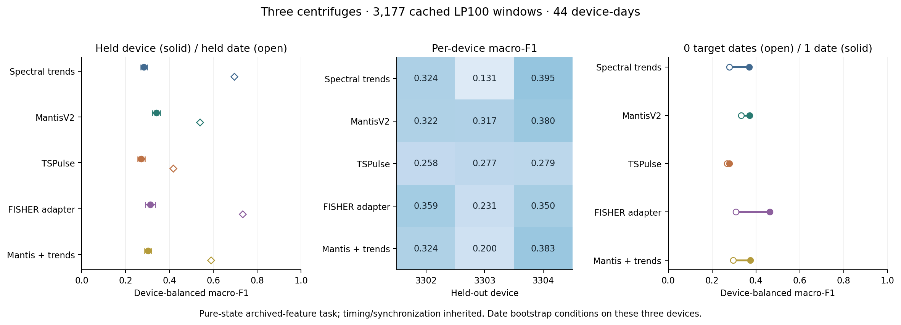
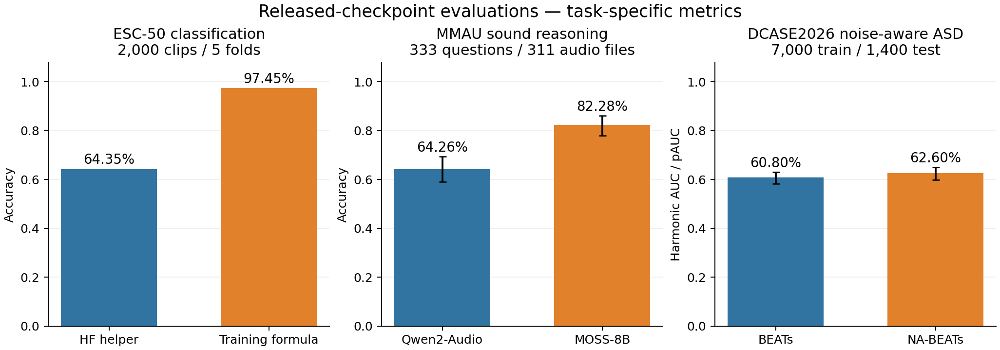

# Audio and near-field magnetic foundation-model baselines

This repository contains task-matched audio evaluations and near-field
magnetic transfer benchmarks for laboratory instruments, including the
28 October 2026 three-centrifuge rebenchmark.
The new work evaluates released checkpoints; it does not repeat large-scale
pretraining or claim a new leaderboard SOTA.

## Three-device magnetic rebenchmark — 28 October 2026

We fixed **3,177 pure-state 20-second magnetic-feature windows from 44
device-days**: 3302 has 1,490 windows/17 dates, 3303 has 603/9, and 3304 has
1,084/18. The common input is an archived LP100 magnetic mel representation
(48×79), with deterministic spacing, a 24-window device/day/class cap, and exact
duplicate exclusion. These are **cached spectral features**; including 3303 does
not certify that its raw timestamp/sampling-clock issue has been repaired.

Primary evaluation trains on two centrifuges and holds out the third (three
folds). Secondary evaluation holds out each date within its own device (44
folds). Both columns below average three device-level four-class macro-F1 values
with equal device weight. Held-date scores aggregate out-of-fold predictions
before scoring, rather than averaging all single-date scores.

| Fixed representation + training-only balanced Ridge | Within-device held-date OOF macro-F1 | Held-device macro-F1 |
| --- | ---: | ---: |
| Spectral statistics + signed trends | 0.6952 | 0.2838 |
| MantisV2, pretrained | 0.5377 | 0.3396 |
| TSPulse, frozen classification backbone | 0.4170 | 0.2713 |
| FISHER-small, magnetic-mel adapter | 0.7332 | 0.3133 |
| MantisV2 + spectral trends | 0.5893 | 0.3025 |
| MantisV2 random encoders, three-seed score mean | 0.5123 | 0.3374 |

The Mantis pretraining-minus-random-mean difference on held devices is
+0.0022, with conditional paired day-bootstrap 95% interval
[-0.0149, +0.0188]. All model/readout settings were fixed before evaluation;
the report retains all random seeds and per-device results.

An additional **one labeled target date** calibration protocol evaluates the
same remaining test dates with and without the calibration data. For the FISHER
adapter, macro-F1 changes from 0.3080
to 0.4637; paired difference
+0.1557, conditional 95% interval
[+0.1322, +0.1771].
One date contains multiple labeled windows; this is not one-shot or unsupervised
adaptation. It is reported separately from the full held-device column.

Clock/log synchronization and absolute acquisition-run IDs remain inherited,
unverified properties. Pure-state filtering excludes transition boundaries;
this task has no physical-fault labels or verified measured RPM. Scores are not
directly comparable to the earlier two-second waveform pilot. Bootstrap intervals
condition on these three devices and fitted models, not a hardware population.

- [Complete English report, sample justification and all controls](results/magnetic_rebenchmark_20261028/REPORT.md)
- [Reproduction commands and pinned adapters](experiments/magnetic_rebenchmark_20261028/README.md)
- [Exact sample index](results/magnetic_rebenchmark_20261028/samples.csv)
- [Metrics, recalls and confusion matrices](results/magnetic_rebenchmark_20261028/summary.json)
- [Every prediction](results/magnetic_rebenchmark_20261028/predictions.csv.gz)
- [Independent verification](results/magnetic_rebenchmark_20261028/verification.json)



## Near-field magnetic transfer pilot — 25 October 2026

The instrument-side input is a single-channel magnetic time series in declared
microtesla. We evaluated released MantisV2 and TSPulse checkpoints and an
explicit FISHER-small magnetic STFT adapter, with physical features and frozen
random-encoder controls. This is a magnetic transfer pilot, not a reproduction
of an established magnetometer SOTA system.

The data audit preselected 1,462 log-anchored windows from three centrifuges.
Strict timing checks retained **343 two-second windows from 3302/3304 over
14 device-days**; all 3303 candidates failed. Every model uses the same
0–100Hz input at 256Hz and the same training-fold scaler and fixed balanced
linear readout. No adjacent windows from a device-day cross a train/test split.

| Frozen representation / fixed readout | Leave-day-out macro-F1, 14 folds | Leave-device-out macro-F1, 2 folds |
| --- | ---: | ---: |
| Physical PSD + amplitude | 0.5222 | 0.3182 |
| MantisV2, pretrained | **0.6079** | **0.4425** |
| MantisV2, random initialized | 0.6049 | 0.4254 |
| TSPulse classification, pretrained | 0.2733 | 0.3098 |
| TSPulse, random initialized | 0.2746 | 0.2769 |
| FISHER-small + magnetic STFT adapter | 0.4926 | 0.4021 |

MantisV2 is the main candidate to retain, but its leave-day-out gain over the
random encoder is only 0.0031; the descriptive paired day interval is
[-0.0456, +0.0562]. A pretraining benefit is not established. The low data
retention, two-device coverage and 100Hz bandwidth prevent broad conclusions.
The operating-state labels do not provide physical fault ground truth.

- [Magnetic evaluation report, limitations and formal sample budget](results/magnetic_baselines_20261025/REPORT.md)
- [Model selection and reproduction commands](experiments/magnetic_baselines_20261025/README.md)
- [Fold metrics](results/magnetic_baselines_20261025/run/results/summary.json)
- [All 4,116 predictions](results/magnetic_baselines_20261025/run/results/predictions.jsonl)
- [Quality accounting](results/magnetic_baselines_20261025/run/results/quality_summary.json)
- [Verified outputs](results/magnetic_baselines_20261025/run/results/verification.json)

## Task-specific evaluations — 25 October 2026

| Task / benchmark | Method | Evaluation size | Measured result |
| --- | --- | ---: | --- |
| Environmental sound classification / ESC-50 | AudioMosaic, five official fold checkpoints | 2,000 held-out clips | Accuracy **97.45%**, macro-F1 0.9743 |
| Audio reasoning / MMAU-test-mini sound | MOSS-Audio-8B-Thinking | 333 questions | **274/333 = 82.28%** |
| Audio reasoning / MMAU-test-mini sound | Qwen2-Audio-7B-Instruct | 333 questions | **214/333 = 64.26%** |
| Noise-aware ASD / DCASE2026 dev | BEATs_iter3, frequency memory banks + RDP4 | 7,000 normal train + 1,400 test | Harmonic source AUC / target AUC / pAUC **60.80%** |
| Noise-aware ASD / DCASE2026 dev | dcase2026_nabeats_seed0, frequency memory banks + RDP4 | 7,000 normal train + 1,400 test | Harmonic source AUC / target AUC / pAUC **62.60%** |
| Machine-condition QA / diagnostic only | MOSS-Audio-8B-Thinking | 200 distinct clips | Accuracy **13.00%**, binary answer coverage 25.50% |
| Machine-condition QA / diagnostic only | Qwen2-Audio-7B-Instruct | 200 distinct clips | Accuracy **50.00%**, binary answer coverage 100.00% |



**Reproduction finding:** the released AudioMosaic HF convenience preprocessing
gave 64.35% ESC-50 accuracy. The author training code uses `(fbank-mean)/(2*std)`;
the convenience function omits the factor of two. Using the training formula
recovers the published five-fold mean of 97.45% (rounded to 97.5% in the paper).
Both complete runs are retained; the correction follows source code, not a test
hyperparameter search.

The corrected Qwen run uses Transformers4.57.1's `audio=` interface and asserts
acoustic features before generation. The initial ignored-`audios=` run is
retained as an invalid-run artifact and excluded from the reported scores.
The original pilot below keeps its documented4.45.2 environment/API.

The QA evaluation additionally includes 60 silent and 60 mismatched MMAU inputs
per model, 200 distinct normal/anomalous machine recordings, and 40 silent plus
40 short machine clips for protocol-defined abstention. Invalid and truncated
answers stay in the denominator. The full report includes uncertainty,
paired tests, per-machine metrics, controls and resource usage.
Repeated MMAU recordings are grouped for uncertainty (333 questions from311
audio hashes); answer choices are imbalanced, with an always-A reference of
49.25%. The report also gives balanced choice accuracy.

The machine diagnostic supplies no machine-specific normal reference. MOSS
abstains on146/200 full clips; Qwen answers NORMAL on all200. MOSS meets the
protocol's abstention expectation on80/80 silent/short controls, versus0/80 for
Qwen. General sound-QA success therefore does not establish fault diagnosis.
For ASD, the observed NA-BEATs gain of1.80 points has a paired95% interval of
[-0.12,+3.66] points, so a stable advantage is not resolved in this run.

- [English evaluation report](results/audio_sota_20261025/REPORT.md)
- [Verified metrics](results/audio_sota_20261025/summary.json)
- [Reproduction commands and pinned assets](experiments/audio_sota_20261025/README.md)
- [Fixed protocol and scope](experiments/audio_sota_20261025/protocol.json)
- [Artifact integrity checks](results/audio_sota_20261025/verification.json)

The DCASE2026 run uses frozen seed0 representations and a documented normal-only
detector. Discriminative fine-tuning, score rescaling and three-seed ensembling
are excluded, so these scores are **not the complete 70.24-point winning system**.
ESC-50 accuracy and MMAU reasoning accuracy measure different abilities from
industrial anomaly detection. All results below from the earlier pilot remain
separate from these larger task-specific evaluations.

## Original 17–23 October pilot

This repository records the 17–23 October 2026 pilot in the accompanying research plan: frozen **BEATs and FISHER** features with nearest-normal-neighbor anomaly scoring, and ten Qwen2-Audio questions on machine recordings. It is a small, reproducible feasibility study, not a submission to the 2020 challenge. Both encoders were released after the challenge's external-resource cutoff.

## Data and fixed protocol

The source is the [DCASE 2020 Task 2 development set](https://zenodo.org/records/3678171) (CC BY-NC-SA 4.0). We use **fan** and **pump**, machine ID **00** for each. A fixed Python RNG seed (`20261022`) samples, without replacement, 100 normal training clips, 50 normal test clips, and 50 anomalous test clips per type. `prepare_subset.py` checks the official archive MD5 values and records the SHA-256 of every extracted clip in `results/dcase2020/manifest.json`. Each recording is approximately 10 seconds of 16 kHz mono audio. The raw audio and model weights are downloaded separately and are not committed here.

The first encoder uses Microsoft's [BEATs implementation](https://github.com/microsoft/unilm/tree/master/beats) at source commit `31c5b904ca1bf2afb4c234a6675c683a4e5fc7cd` and its **pre-trained BEATs_iter3** checkpoint ([checkpoint mirror](https://huggingface.co/lpepino/beats_ckpts), revision `5b53b0404df452a3a607d7e67687227730e5bad1`). It mean-pools time-frame embeddings and L2-normalizes each clip.

The second encoder is the official [FISHER-small-0723](https://huggingface.co/jiangab/FISHER-small-0723/tree/1fb316962ebb863d570217b12b40fb0ec1e957c5), fixed at revision `1fb316962ebb863d570217b12b40fb0ec1e957c5`. Its weights and custom inference code are downloaded together; `run_metadata.json` records their SHA-256 values. The weight SHA-256 is `9924cdeec51ea796557af0c1920f0a2148303b3c26d2b41a39dbb8c4ff94fb4a`, checked against the official checkpoint. The local custom code is loaded with `trust_remote_code=True` after review of the pinned files.

FISHER follows its [pinned model-card inference example](https://huggingface.co/jiangab/FISHER-small-0723/blob/1fb316962ebb863d570217b12b40fb0ec1e957c5/README.md): subtract the waveform mean, compute a magnitude STFT with a 25 ms Hann window and 10 ms hop (`n_fft=400`, `hop_length=160`, `power=1`, `center=False`), take `log(magnitude + 1e-10)`, and normalize by `(log_magnitude + 3.017344307886898) / (2 * 2.1531635155379805)`. The time axis is truncated to at most 1024 frames and is not padded. Each selected clip produces a `[1, 1, 998, 201]` input. The official model concatenates four 384-dimensional sub-band CLS vectors into a 1536-dimensional representation; we L2-normalize this vector. These settings are explicit in `fisher_config.json`. The [full RMIS wrapper](https://github.com/jianganbai/RMIS/blob/90c05bbc6009f1c8503094b0b9eb536d78ae7af8/models/fisher/fisher.py) also pads shorter inputs to 1024 frames; this pilot uses the Hugging Face model-card protocol and does not reproduce the complete RMIS benchmark.

Both encoders use **the same 400 selected files, normal training banks, and scoring rule**. For a test clip, the anomaly score is `1 - max(cosine_similarity(test, training_normal))` within the same type and ID. No model fine-tuning or score calibration is performed.

Test labels are used only to construct the balanced evaluation subset and calculate metrics; they never enter the embedding, nearest-neighbor bank, scoring, or any threshold. This experiment selects **no decision threshold**. We report AUROC and the scikit-learn standardized pAUC with `max_fpr=0.1`, matching the [official baseline configuration](https://github.com/y-kawagu/dcase2020_task2_baseline/blob/master/baseline.yaml). Higher anomaly scores mean more likely anomalous. The [challenge task page](https://dcase.community/challenge2020/task-unsupervised-detection-of-anomalous-sounds) explains the task and low-FPR metric.

## BEATs and FISHER nearest-neighbor results

| Encoder | Machine type | ID | Normal train | Normal test | Anomalous test | AUROC | pAUC, FPR ≤ 0.1 |
| --- | --- | --- | ---: | ---: | ---: | ---: | ---: |
| BEATs_iter3 | fan | 00 | 100 | 50 | 50 | 0.5932 | 0.5242 |
| FISHER-small | fan | 00 | 100 | 50 | 50 | 0.4980 | 0.4863 |
| BEATs_iter3 | pump | 00 | 100 | 50 | 50 | 0.7176 | 0.5832 |
| FISHER-small | pump | 00 | 100 | 50 | 50 | 0.7024 | 0.5032 |

Each encoder's exact metrics, checkpoint identity, per-file scores, and runtime metadata are stored in `results/beats_knn/` and `results/fisher_knn/`. FISHER additionally saves all 400 normalized vectors in `embeddings.npz` with their paths. `compare_baselines.py` verifies identical test paths, labels, groups and manifest hashes, recomputes AUROC/pAUC from all 200 saved scores per encoder, and reconstructs FISHER scores from squared Euclidean distances between unit vectors. Its verification and descriptive metric differences are saved in `results/baseline_comparison.json`.

On this fixed subset, **FISHER does not improve on BEATs**. Fan discrimination is around chance with FISHER, while pump AUROC is similar to BEATs but its low-FPR pAUC is lower. Both AUROC and this standardized pAUC have a random-ranking reference of 0.5. There is no score-sign reversal, threshold tuning, or configuration selection using the test results. The comparison covers one ID per type and one subset seed; it establishes neither a statistically significant model ranking nor agreement with full DCASE/RMIS leaderboard results. Model-specific preprocessing and pretraining also differ, so the comparison does not isolate the encoder architecture.

## Qwen2-Audio questions

We use [Qwen2-Audio-7B-Instruct](https://huggingface.co/Qwen/Qwen2-Audio-7B-Instruct), revision `0a095220c30b7b31434169c3086508ef3ea5bf0a`, in audio-analysis mode without fine-tuning. The ten **distinct source recordings** comprise four normal and four anomalous full-length clips (two of each condition from each machine type), plus two separate 0.25-second center excerpts. The excerpts are intentionally too short for a reliable condition judgment; “insufficient evidence” is a protocol expectation, not a DCASE annotation. The DCASE normal/anomaly labels are hidden from the model prompt.

The fixed prompt asks for `NORMAL`, `ANOMALOUS`, or `INSUFFICIENT EVIDENCE` followed by a brief audible reason, and forbids guessing an exact fault or operating setting. `results/qwen/qwen_raw.jsonl` retains the source path and SHA-256, segment timing and PCM hash, literal prompt and rendered chat template, unedited response, parsed answer, model revision, and generation settings for each case. The audio is supplied as a waveform array; the rendered template contains an audio token, not the source filename or condition label. `results/qwen/error_summary.json` groups basic label errors, abstentions, and format failures; `results/qwen/manual_review.json` records additional qualitative observations tied to case IDs.

| Error type | Count |
| --- | ---: |
| Wrong condition on a full clip | 4 |
| Correct condition on a full clip | 4 |
| Unnecessary abstention on a full clip | 0 |
| False certainty on a short excerpt | 2 |
| Response format failure | 0 |

All ten raw replies begin with `ANOMALOUS` (some use mixed case). This gives four false alarms among four normal full clips, four correct tags among four anomalous full clips, and no abstention on either 0.25-second excerpt. The model recycled nearly the same pitch/loudness explanation for both normal and anomalous fan clips (cases 01 and 05). Case 07 also asserted that a pump should sound different “at idle,” although the prompt supplied no operating-state reference. These are answer-level observations, not verified physical diagnoses. The ten questions are a diagnostic probe, not an accuracy estimate. A short excerpt's “insufficient” expectation is an assessment rule, not a claim that its parent recording lacks a DCASE condition label.

## Reproduce

The recorded A800 environment used Python 3.10, PyTorch `2.0.1+cu118`, TorchAudio `2.0.2+cu118`, Transformers `4.45.2`, Accelerate `0.34.2`, and Hugging Face Hub `0.25.2`. TorchAudio must match PyTorch's CUDA build. Other Python dependencies are listed in `requirements.txt`. BEATs extraction ran on the A800 host's CPU with eight threads, and Qwen2-Audio ran there in float32 on 16 CPU threads, because the GPU was occupied by another user's training job.

```bash
python prepare_subset.py --root data/dcase2020 --config config.json
HF_ENDPOINT=https://hf-mirror.com python download_models.py --out models
git clone --depth 1 --filter=blob:none --sparse https://github.com/microsoft/unilm.git external/unilm
git -C external/unilm sparse-checkout set beats
OMP_NUM_THREADS=8 MKL_NUM_THREADS=8 python run_beats_knn.py --root data/dcase2020 --checkpoint models/beats/BEATs_iter3.pt --beats-source external/unilm/beats --out results/beats_knn --config config.json --device cpu
OMP_NUM_THREADS=16 MKL_NUM_THREADS=16 python run_qwen_audio.py --root data/dcase2020 --model models/qwen2-audio --out results/qwen --config config.json --device cpu
python analyze_qwen.py --input results/qwen/qwen_raw.jsonl --out results/qwen/error_summary.json
```

For exact source reproduction, check out the BEATs source commit above. The Qwen and BEATs checkpoint revisions are pinned in `download_models.py`. `run_qwen_audio.py` writes after each case and skips completed case IDs on restart.

FISHER used a separate Python 3.10 environment with PyTorch/TorchAudio `2.3.1+cpu`, TorchVision `0.18.1+cpu`, Transformers `4.45.2`, `timm==0.9.16`, `omegaconf==2.3.0`, and `einops==0.6.1`. The initial PyTorch 2.0.1 environment failed because the official attention code passes a `scale` keyword to `scaled_dot_product_attention`; its preserved traceback is `results/fisher_knn/torch20_failure.txt`. The successful run loads all checkpoint keys without omissions, uses float32 and eight CPU threads, and takes 31.3 seconds as measured inside the script. Peak process RSS is approximately 643 MiB, with zero GPU allocation. These timings come from different software environments and are not a controlled speed comparison with BEATs.

After preparing the same subset above, reproduce FISHER in a separate environment:

```bash
python3.10 -m venv .venv-fisher
source .venv-fisher/bin/activate
python -m pip install torch==2.3.1 torchaudio==2.3.1 torchvision==0.18.1 --index-url https://download.pytorch.org/whl/cpu
python -m pip install -r requirements-fisher.txt
HF_ENDPOINT=https://hf-mirror.com python download_fisher.py --out models/fisher-small --config fisher_config.json
OMP_NUM_THREADS=8 MKL_NUM_THREADS=8 OPENBLAS_NUM_THREADS=8 python run_fisher_knn.py --root data/dcase2020 --model models/fisher-small --out results/fisher_knn --config config.json --fisher-config fisher_config.json --device cpu --threads 8
python compare_baselines.py --results results
deactivate
```

All computed results and the selected-file manifest are committed under `results/`; raw licensed WAV files and model checkpoints stay outside Git.

## Limits

The subset is small and drawn from only one ID per type. Clip-level mean pooling can hide brief anomalies. Training and test clips come from the official development archive, with its original split preserved, but this pilot does not measure domain shift or cross-device generalization. Qwen replies are evaluated only against the recorded DCASE condition or the deliberately short-clip abstention rule; they are not evidence of a physical fault diagnosis.
